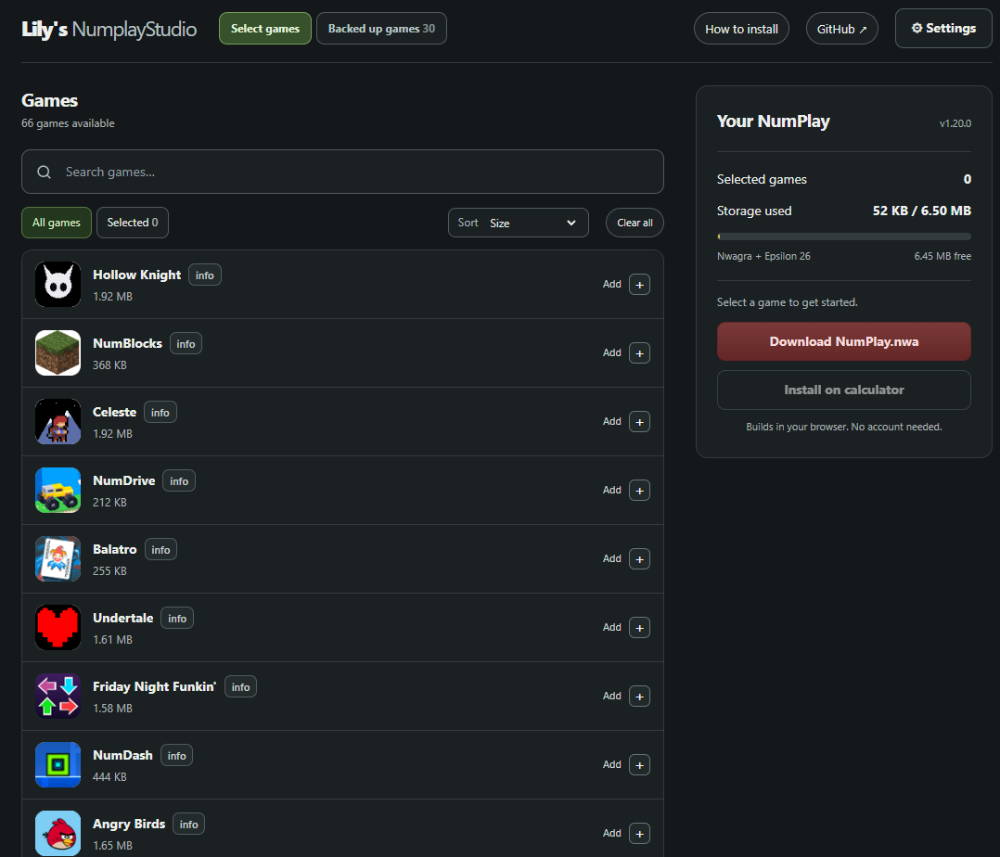
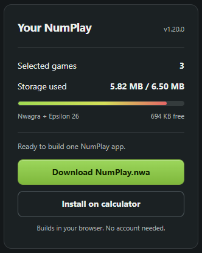
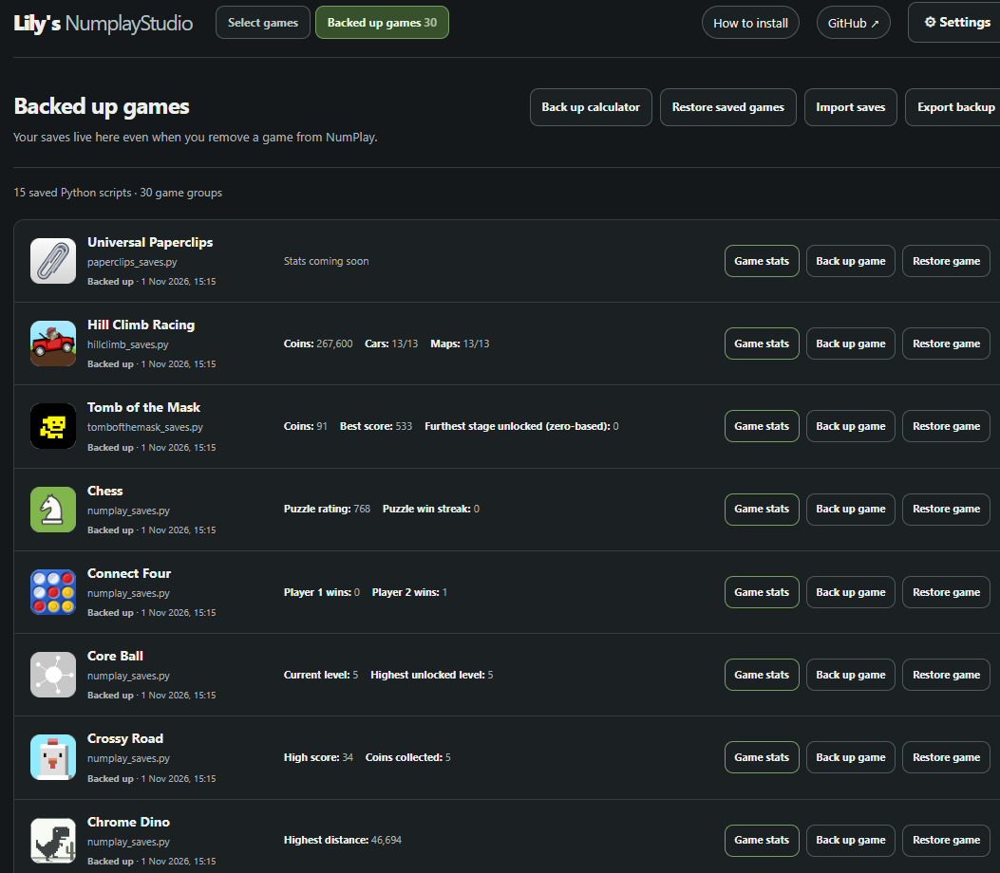

# Lily's NumplayStudio

### [Open Lily's NumplayStudio](https://lilythecutecatgirl.github.io/Lilys_Numplay_Studio/)

Lily's NumplayStudio is a small site to chose the games you want to add on your numworks calculator from [NumPlay](https://github.com/Mason363/NumPlay), a collection of games for NumWorks calculators.
The Studio also includes tools for installing your application and managing your game saves.

# Features

###  Choose your games

Build a personalized collection containing your favorite NumPlay games.

- Browse the available game library.
- Search for specific games.
- Sort games alphabetically, by recommended order, or by size.
- Select and remove games from your build.
- Rearrange selected games to control their order in NumPlay.
- View additional information about individual games.

You chose which games you instal

### Storage management

NOTICE: NumWorks calculators have limited application storage. not all the games can fit in at once

- Live storage usage estimates.
- A visual storage progress bar.
- Information about remaining available space.
- Warnings when a game cannot fit.
- Storage configurations for supported firmware setups.

###  Customize your NumPlay

- **Application name:** Give your NumPlay app a custom name.
- **Application icon:** Select an available icon or upload your own.
- **Language:** Choose from the languages available in the NumPlay kit.
- **Launch appearance:** Choose the normal NumPlay appearance or an alternative Matrices mode.

Your game selection and preferences can be remembered in the browser.

### Build directly in your browser

Once you've selected your games, the Studio can assemble a customized NumPlay application.
The builder uses the NumPlay game kit and linker to generate a downloadable `.nwa` application file.

**No compiler installation or account is required for normal website use.**

# Install the games on your calculator

There are two ways to install your application:

**Option 1 Download and install manually**

Download your generated `NumPlay.nwa` file and install it through the [official NumWorks application installer](https://my.numworks.com/apps).

**Option 2  direct USB installation**

On supported browsers and calculators, Lily's NumplayStudio can communicate with your calculator over USB.
The direct installer is designed to back up calculator saves, install your selected application, and restore saved progress after the calculator restarts.

**Important:** Direct USB installation is. Installing an application may replace other extra applications or affect saved data. Always export backups before making changes.

##  Save Vault protect your game progress

The **Save Vault** provides a dedicated space for managing supported NumPlay game saves.

- Back up supported game saves from a connected calculator.
- Keep browser backups even after removing a game from NumPlay.
- Import existing save backups.
- Export your saved data for safekeeping.
- View game-specific saved statistics where supported.
- Edit certain supported game save formats.
- Restore compatible backups to your calculator using the USB tools.

Some save formats only support viewing, while others include editing capabilities.

### Where are my saves stored?

Save Vault stores its backups locally in your browser using browser storage.
Your backups are not stored in an online account or uploaded to a save server.

**Please remember:**

- Clearing your browser's site data may delete your local backups.
- Export important backups to keep a separate copy.
- Editing a backup in your browser does not automatically update your calculator.
- Restoring saves to a calculator is a separate action.
- Some game formats or older save versions may have limited support.

## Retro-Go support

For users who want to include retro games, the Studio supports adding compatible ROM files when Retro-Go is available
